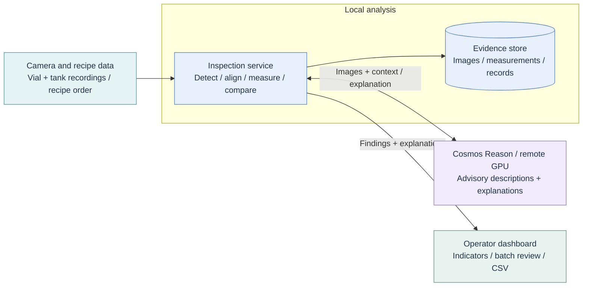

# Presentation architecture

Insert `architecture.svg` as a picture. It is a 1600 x 900 (16:9) vector diagram
with a white technical pipeline panel, teal title block, nested services, and technology
icons inspired by the previous-year reference in image.png. Endpoints, ports and tunnel details are omitted
for readability. React and FastAPI use recognizable technology symbols; camera, GPU, storage and monitor icons are schematic.

The five blocks are camera/recipe inputs, local inspection, evidence storage,
remote Cosmos Reason and operator review. Explanations return through the local
service; Cosmos cannot override measured findings. Inputs are currently recordings.
Third-vial reference comparisons are retrospective.

Editable Mermaid equivalent:

The earliest minimal illustration remains in `architecture-simple.svg`.

